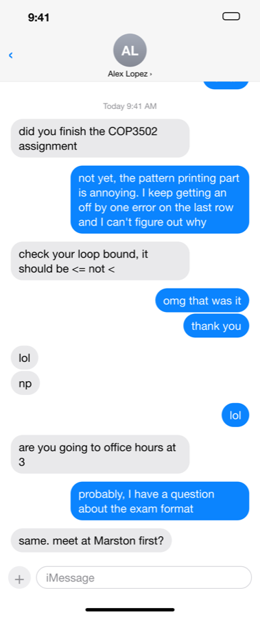
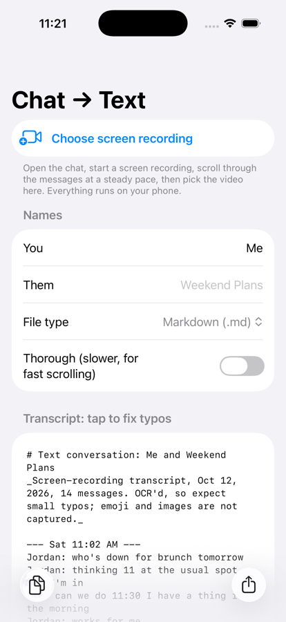
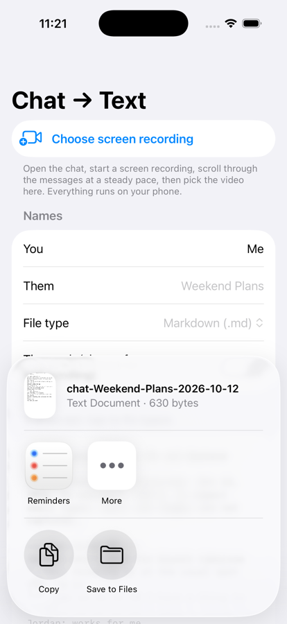

# Screen Recording to Text: transcribe text conversations from a video (iPhone, on-device OCR)

**Turn a screen recording of your messages into a clean, speaker-labelled transcript (`.md` or `.txt`).**
Record yourself scrolling through an iMessage, SMS, or group chat, pick the video, and get back

```
Alex Lopez: did you finish the COP3502 assignment
Me: not yet, the pattern printing part is annoying...
Alex Lopez: check your loop bound, it should be <= not <
```

An iOS app (SwiftUI + Apple Vision) that extracts the text from a video, works out **who said what**,
removes the duplicates that come from scrolling, and saves the conversation as a text file. It runs entirely
on your phone, with no server, no account and no upload.


-green)


| Screen recording frame (input) | Transcript (output) | Share to Claude / ChatGPT / Files |
|:---:|:---:|:---:|
|  |  |  |

---

## Why

- **Send a whole conversation to an AI cheaply.** Screenshots of a chat cost roughly 1,500 tokens *each*
  for an LLM to read. The same 27-message chat as text ([sample](docs/sample-output.md)) is about 300 tokens,
  **roughly 10–15× fewer** than the three screenshots it replaces, and the model can't misread who sent what.
- **Save or export a text conversation** as a plain file you can search, archive, quote, or paste anywhere.
- **No copy-paste one bubble at a time.** One screen recording captures hundreds of messages.

## Features

- 🎥 **Video → text**: samples frames from any screen recording in your Photos library
- 🗣️ **Speaker detection**: you vs. them, plus **group chat sender names**
- 🔁 **Scroll de-duplication**: frames overlap heavily, so they're stitched with fuzzy sequence alignment and each message appears once. Scroll **up or down**.
- 🕒 Keeps **timestamps** ("Today 9:41 AM") as section markers; drops "Delivered" / "Read" receipts
- 🌗 Works in **light and dark mode**, blue iMessage and green SMS bubbles, and custom chat backgrounds
- 🧹 Ignores the Control Center frames at the start/end of every screen recording
- ✏️ Edit the transcript in-app to fix typos, rename speakers, then **Copy** or **Share** as `.md` / `.txt`
- 🔒 **100% on-device** (Apple Vision text recognition). Nothing leaves your phone.
- ⚠️ Marks spots where you scrolled too fast with `[…some messages may be missing here…]` rather than guessing

## Install (free, no App Store)

You need a Mac with Xcode and a free Apple ID.

```bash
git clone https://github.com/Bman321123/screen-recording-to-text.git
cd screen-recording-to-text
open ChatTranscriber.xcodeproj
```

1. In Xcode → target **ChatTranscriber** → **Signing & Capabilities**, choose your **Personal Team**
   (add your Apple ID under Xcode → Settings → Accounts if none is listed).
2. Plug in your iPhone, unlock it, tap **Trust**, and select it in the device menu at the top of Xcode.
3. Turn on **Developer Mode** on the phone: Settings → Privacy & Security → Developer Mode (restart).
4. Press **⌘R**.
5. First launch says *Untrusted Developer*: Settings → General → **VPN & Device Management** →
   your Apple ID → **Trust**.

> Free Apple IDs sign apps for 7 days. When it stops opening, plug in and press ⌘R again.

If you edit `project.yml`, regenerate the project with [XcodeGen](https://github.com/yonaskolb/XcodeGen): `xcodegen generate`.

## How to use

1. Open **Control Center** → start **Screen Recording**.
2. Open the conversation and **scroll through it at a steady pace** (either direction).
3. Stop the recording.
4. In **Chat → Text**, tap **Choose screen recording** and pick the video.
5. Optionally set your name (default "Me"). The other person's name is read from the chat header.
6. Tap **Share** to send the file to the Claude or ChatGPT app, Notes, Files, email…, or **Copy**.

**Tip:** steady scrolling beats fast flicking. If you scroll fast, turn on **Thorough** (8 frames/sec instead of 4).

## How it works

```
video ─► sample frames (4–8 fps, skip unchanged) ─► OCR each frame (Apple Vision)
      ─► find bubbles + speaker per frame ─► align overlapping frames ─► vote on text ─► Markdown
```

**Speaker detection doesn't depend on colour names**, which is why it survives dark mode and custom backgrounds:

1. A text line is *inside a bubble* if the pixels just beside its OCR box differ from the local background.
2. Scan outward to find the bubble's left and right edges.
3. A bubble that hugs the **right** edge is *you*; one hugging the **left** is *them*.
4. Lines belong to the same message if a vertical scan through the bubble's side padding never hits background.
5. Small un-bubbled text just above a left bubble is a **group-chat sender name**; centered un-bubbled text is a **timestamp**.

**Stitching frames together** (`Core/TranscriptMerger.swift`): each frame's bubble list is locally aligned
(Smith–Waterman style) against the transcript so far, using fuzzy text similarity plus same-speaker matching.
Matched bubbles **vote** on their text so one-off OCR errors get outvoted, and a bubble half-hidden under
the header loses to its complete version. Frames that don't overlap anything start a new stretch. Stretches
are joined in the order they were scrolled through, with a visible gap marker between them.

| File | What it does |
|---|---|
| `Core/FrameAnalyzer.swift` | OCR + bubble/speaker/name/timestamp detection for one frame |
| `Core/TranscriptMerger.swift` | Fuzzy alignment, voting, multi-segment stitching |
| `Core/VideoTranscriber.swift` | Frame sampling, non-chat frame filtering, Markdown/TXT rendering |
| `ChatTranscriber/ContentView.swift` | The SwiftUI app (Photos picker, progress, editor, share) |
| `verify/`, `testgen/` | Mac test harness + synthetic screen-recording generator |

## Accuracy & testing

`Core/` compiles on macOS too, so the exact pipeline the phone runs can be tested from the command line
against **synthetic screen recordings with known ground truth**: an iMessage look-alike rendered by headless
Chrome, composited into a scrolling H.264 video, Control Center frames included.

```bash
swiftc -O Core/*.swift verify/main.swift -o build/verify
swiftc -O testgen/makevideo.swift -o build/makevideo
./testgen/shoot.sh /tmp/t light dm            # or: dark group
./build/makevideo /tmp/t /tmp/t.mp4 up        # or: down   (FLICK=0.9 TTIME=0.2 for fast scrolling)
./build/verify /tmp/t.mp4 > /tmp/t.md
python3 testgen/score.py /tmp/t/truth.json /tmp/t.md
```

| Scenario | Result |
|---|---|
| 1:1 chat, light mode, scrolling up / down | 27/27 lines exact |
| Group chat with names + avatars, dark mode, up / down | 16/16 lines exact |
| Fast flicks (80% of a screen per flick) at 2 fps | 27/27 lines exact |
| Extreme flicks (95% of a screen in 150 ms) | all messages, in order, plus a gap marker |

## Limitations

- Reads **text only**: emoji-only messages, photos, stickers, and voice notes aren't captured.
- Tuned for Apple **Messages** layouts; WhatsApp / Instagram / Messenger use the same left/right-bubble idea
  and often work, but aren't tested yet.
- English OCR by default (`recognitionLanguages` in `FrameAnalyzer.swift`).
- Only messages that actually appear in the recording can be transcribed. Scroll through everything you want.

## FAQ

**How do I transcribe the text in a video on my iPhone?**
Screen-record (or pick any video showing text), open it in this app, and it runs on-device OCR on the frames,
then stitches the results into one de-duplicated text file.

**How do I export an iMessage conversation to a text file / PDF / Markdown?**
iOS has no built-in iMessage export. Record yourself scrolling the thread and run it through this app to get a
`.md` or `.txt` with every message labelled by sender. Print or save as PDF from the share sheet if you need one.

**How do I give ChatGPT or Claude a whole text conversation without dozens of screenshots?**
Share the generated Markdown file straight to the app. It's a fraction of the tokens and keeps who-said-what exact.

**Does it upload my messages anywhere?**
No. Text recognition uses Apple's on-device Vision framework. The app makes no network requests.

**Can it convert a screen recording to text on a Mac?**
Yes, `verify/main.swift` runs the same pipeline on any video file from the command line.

## Roadmap ideas

- Share extension ("Share → Chat → Text" straight from Photos)
- Tested presets for WhatsApp, Instagram DMs, Messenger, Discord, Slack
- Emoji/attachment placeholders (`[photo]`, `[sticker]`)
- More OCR languages

PRs welcome. Run the test harness above before and after changes.

## License

[MIT](LICENSE) © 2026 Benjamin Friedman

<sub>Keywords: screen recording to text, video to text, transcribe text from video, OCR video iPhone, extract text from screen recording,
iMessage export, text message transcript, save text conversation, chat to markdown, conversation transcriber, SMS backup to text,
group chat export, Apple Vision OCR, SwiftUI, LLM context, ChatGPT, Claude.</sub>
